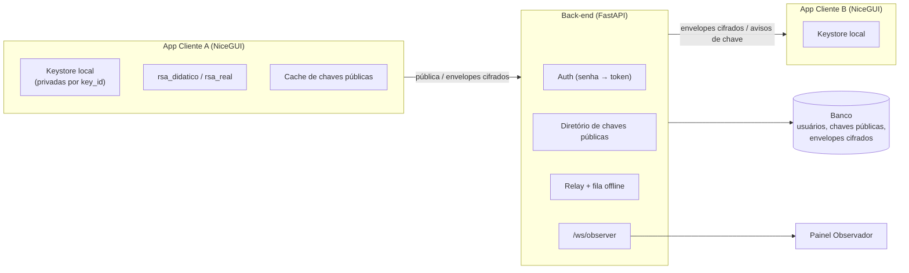
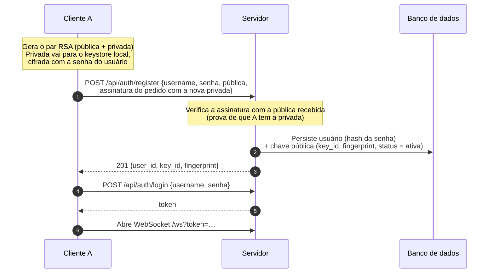
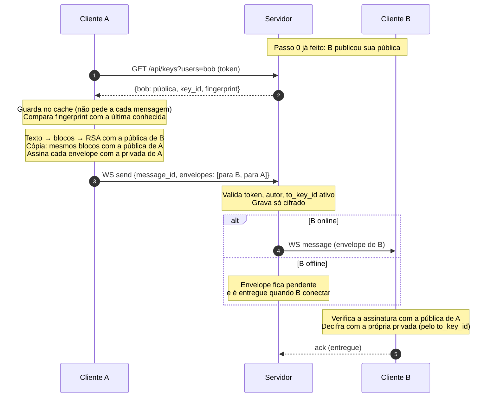
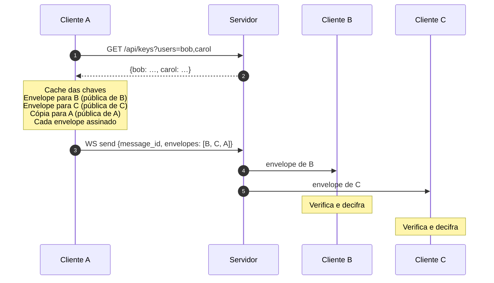
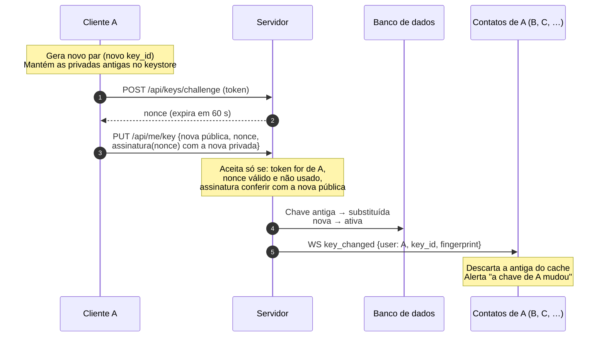
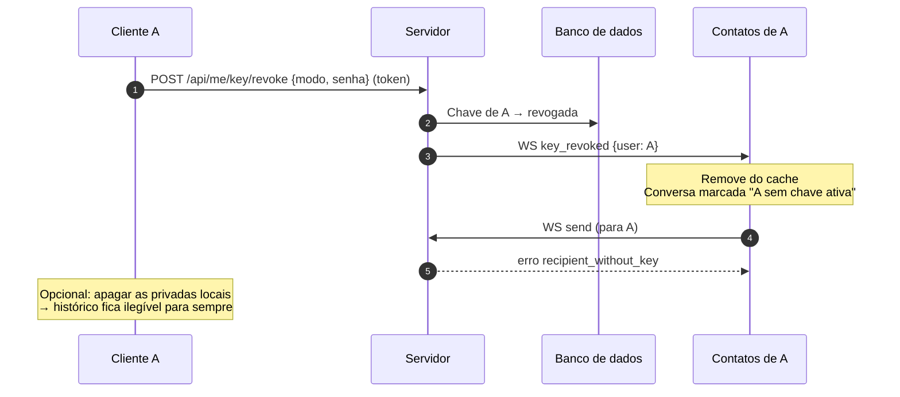

# CriptoChat RSA — Plano de Implementação (v2)

Mensageiro ponta a ponta com **RSA puro**, CRUD de clientes e servidores, simulação de criação e remoção da criptografia e visualização explícita do caminho da mensagem.

| | |
|---|---|
| **Stack** | Python 3.11+ — back-end FastAPI, front-end NiceGUI |
| **Autores** | Enzo Ávila, Gabriel Benayon e Thiago Ramon |
| **Disciplina / Professora** | Segurança da Informação — [preencher] |
| **Instituição** | Universidade do Estado do Amazonas (UEA) |
| **Versão** | v2 — outubro de 2026 (revisão do rascunho v1 de setembro) |

> **Fonte de verdade:** os diagramas de fluxo da equipe (Gerenciamento de chaves, A → B, A → B e C, Troca ou exclusão) são a parte definitiva do projeto. A seção 5 os reproduz, já com as correções. Sempre que outra seção conflitar com eles, valem os diagramas.

---

## 0. O que mudou em relação ao rascunho v1

| # | Rascunho v1 | v2 | Motivo |
|---|---|---|---|
| 1 | Modo real **híbrido** (AES-256-GCM + RSA cifrando a chave AES, campo `wrapped_key`) | **RSA puro** nos dois modos. Texto dividido em blocos; cada bloco cifrado com RSA-OAEP (modo real) ou RSA de livro (modo didático) | Decisão da equipe: o trabalho é sobre RSA |
| 2 | Nenhuma autenticação; `/ws/{client_id}` aceita qualquer um | Cadastro com senha, login com token, WebSocket autenticado; ações sobre chaves exigem token | Sem isso o servidor não sabe quem pede chaves ou troca a chave de A (qualquer um se passaria por A) |
| 3 | Geração de chaves solta (RF03) | **Passo 0 = cadastro**: o cliente gera o par e publica a pública, com prova de posse | Diagrama "Gerenciamento de chaves" |
| 4 | Envelope único com um `to` | **Um envelope por destinatário**, cada um assinado | Diagrama "A → B e C", passo 2 |
| 5 | Sem cópia para o remetente | Envelope extra cifrado com a própria pública de A | Sem ele A não consegue reler o histórico |
| 6 | Assinatura RSA-PSS com prioridade média | **Obrigatória**, por envelope, cobrindo os metadados | Sem ela B não sabe se a mensagem veio de A: qualquer um cifra com a pública de B |
| 7 | "Contato recebe alerta" ao rotacionar | Servidor avisa **todos** que têm a chave de A em cache; cliente descarta a antiga | Diagrama "Troca ou exclusão" + correção |
| 8 | Rotação sem regra de quem pode | Troca só com A autenticado + assinatura de um desafio com a **nova** privada | Correção do diagrama de troca |
| 9 | Chave antiga some | Privadas antigas ficam no keystore, versionadas por `key_id` | Ler mensagens antigas depois da troca |
| 10 | Exclusão só como "revogar" | Fluxo de exclusão completo: revoga, avisa contatos, recusa novas mensagens | Diagrama "Troca ou exclusão" (exclusão estava só no título) |
| 11 | `Message` com um `payload` | `Message` + `Envelope` (um por destinatário, com status de entrega) | Grupo, cópia do remetente e fila offline |
| 12 | Prioridades planas | Fluxos dos diagramas = **obrigatórios**; nós, visualizações avançadas e simulações = depois | Garantir o núcleo antes dos extras |
| 13 | Apêndice B: `e=17` fixo, sem Miller-Rabin, `import secrets` sem uso | Lista de correções no Apêndice B | O esboço falharia com primos aleatórios |

---

## 1. Visão geral

O CriptoChat RSA é um mensageiro no estilo WhatsApp/Telegram com objetivo didático: tornar visível o que acontece numa troca de mensagens cifradas ponta a ponta (E2E). Cada etapa do RSA — geração de chaves, conversão do texto em números, cifragem, assinatura, trânsito pelo servidor, verificação e decifragem — vira um evento exibido em painéis, sem depurador.

Dois processos Python independentes:

- **Back-end (FastAPI):** autentica usuários, mantém o diretório de chaves públicas e retransmite envelopes cifrados. **Nunca** recebe chave privada.
- **Front-end (NiceGUI):** representa o aplicativo no aparelho do usuário. Gera as chaves, guarda a privada localmente, cifra, assina, verifica e decifra.

### 1.1 Objetivos

- Implementar RSA **do zero** (modo didático, números legíveis) e com a biblioteca `cryptography` (modo real, RSA-OAEP 2048 bits + RSA-PSS).
- Implementar fielmente os fluxos dos diagramas: cadastro (passo 0), A → B, A → B e C, troca e exclusão de chave.
- CRUD de clientes (usuários) e de servidores (nós de retransmissão).
- Simular a criação e a remoção da criptografia (gerar, trocar, revogar e apagar chaves).
- Visualizar o caminho cliente → servidor(es) → cliente e o estado da mensagem em cada salto.

### 1.2 Fora do escopo

- Criptografia híbrida (AES + RSA). Será citada como evolução e como explicação do limite de tamanho.
- Signal Protocol / Double Ratchet / sigilo futuro (citados como evolução).
- App móvel nativo, push, voz/vídeo, implantação em nuvem.

---

## 2. Requisitos

### 2.1 Requisitos funcionais

**Obrigatório** = está nos diagramas ou nas correções deles. **Importante** = título/objetivo do trabalho. **Desejável** = se sobrar tempo.

| ID | Requisito | Prioridade | Fluxo |
|---|---|---|---|
| RF01 | Cadastro: o cliente gera o par RSA localmente e publica só a pública, com prova de posse | Obrigatório | 5.1 |
| RF02 | Login com senha → token; WebSocket e rotas protegidas exigem token | Obrigatório | 5.1 |
| RF03 | Diretório de chaves: buscar a chave pública ativa de 1 ou N usuários (com `key_id` e fingerprint) | Obrigatório | 5.2, 5.3 |
| RF04 | Cache de chaves no cliente, invalidado por aviso do servidor | Obrigatório | 5.2, 5.4 |
| RF05 | Mensagem 1:1 cifrada com RSA puro (blocos) e decifrada só pelo destinatário | Obrigatório | 5.2 |
| RF06 | Mensagem para grupo: um envelope por destinatário | Obrigatório | 5.3 |
| RF07 | Assinatura RSA-PSS de cada envelope; o destinatário verifica com a pública do remetente | Obrigatório | 5.2 |
| RF08 | Cópia do remetente cifrada com a própria pública | Obrigatório | 5.2 |
| RF09 | Entrega a destinatário offline quando ele conectar | Obrigatório | 5.2 |
| RF10 | Troca de chave: só o dono autenticado, com prova de posse; chave versionada por `key_id`; todos os contatos avisados | Obrigatório | 5.4 |
| RF11 | Exclusão de chave: servidor revoga, avisa contatos e recusa novas mensagens para o usuário | Obrigatório | 5.5 |
| RF12 | CRUD de clientes (listar, editar, remover — criação é o cadastro RF01) | Importante | — |
| RF13 | CRUD de servidores/nós (nome, host, porta, região, on/off) e caminho com saltos | Importante | — |
| RF14 | Modo didático (RSA do zero) e Inspetor com cada etapa matemática | Importante | — |
| RF15 | Painel Observador: caminho da mensagem e "visão do servidor" | Importante | — |
| RF16 | Desligar/religar E2E por conversa (demonstração do que o servidor passa a ver) | Desejável | — |
| RF17 | Simulação de MITM (servidor troca a pública de B) com alerta de fingerprint | Desejável | — |
| RF18 | "Quebrar chave" pequena (fatorar n) e gráfico de tempo por tamanho de chave | Desejável | — |

### 2.2 Requisitos não funcionais

- **Privacidade:** a chave privada nunca sai do processo do cliente (teste automatizado inspeciona tráfego e banco).
- **Rastreabilidade:** todo passo criptográfico gera um `TraceEvent` (entrada, saída, duração).
- **Tempo real:** entrega < 300 ms em rede local.
- **Portabilidade:** `docker compose up` sobe back-end, dois clientes e o observador.
- **Qualidade:** cobertura ≥ 80% no módulo de criptografia.

---

## 3. Stack tecnológica

Sem mudanças em relação ao v1, exceto a remoção do AES.

| Camada | Tecnologia | Justificativa |
|---|---|---|
| Back-end | FastAPI + Uvicorn | Assíncrono, WebSocket nativo, Swagger para demonstrar a API |
| Persistência | SQLAlchemy 2 + SQLite (Alembic opcional) | SQLite dispensa instalação na apresentação |
| Validação | Pydantic v2 | Schemas do envelope e dos CRUDs compartilhados entre as pontas |
| Front-end | NiceGUI | UI reativa em Python, `ui.echart`, `ui.mermaid`, `ui.timeline` |
| Cliente HTTP/WS | httpx + websockets | REST e WebSocket a partir do app cliente |
| Criptografia | Implementação própria + `cryptography` | Própria para expor números; biblioteca para OAEP e PSS |
| Senhas | `argon2-cffi` (ou `bcrypt`) | Hash de senha no servidor |
| Testes | pytest + hypothesis + pytest-asyncio | Testes de propriedade: `decifrar(cifrar(m)) == m` |
| Infra | Docker Compose | Sobe tudo de uma vez |

Alternativas avaliadas: Streamlit (recarrega a página inteira, ruim para chat) e Flet (menos componentes prontos de diagrama).

---

## 4. Arquitetura

Modelo cliente–relay dos mensageiros E2E. O "Servidor" dos diagramas é o back-end. Os "servidores" do CRUD (RF13) são **nós lógicos de retransmissão** dentro do back-end: servem para mostrar saltos no Observador, mas não mudam os fluxos — o diretório de chaves e a autenticação são centrais.



**Fronteira de confiança:** a chave privada fica só no processo do cliente. O back-end é outro processo e só recebe chaves públicas e texto cifrado.

### 4.1 Responsabilidades

- **App Cliente:** telas de chat e CRUD; geração de chaves; keystore local; cache de chaves públicas; cifra, assina, verifica e decifra; emite `TraceEvent`s locais (podem conter texto claro, nunca saem do cliente).
- **Back-end:** autenticação; diretório de chaves; validação de envelopes (`key_id` ativo, tamanho, autor); armazenamento só de cifrado; entrega e fila offline; avisos de troca/exclusão de chave; CRUDs; `/ws/observer` com eventos de trânsito (só o que o servidor enxerga).
- **Painel Observador:** página que assina `/ws/observer` e desenha o caminho, a "visão do servidor" e a "visão do interceptador".

---

## 5. Fluxos (definitivos — reproduzem os diagramas)

### 5.1 Passo 0 — Cadastro e geração de chaves

A chave privada é gerada e salva pelo cliente. Jamais trafega pela rede. O servidor persiste a pública e a entrega a qualquer usuário autenticado que pedir.



### 5.2 A → B



### 5.3 A → B e C

Igual ao 5.2, mas o passo 1 pede **todas** as chaves de uma vez e o passo 2 gera **um envelope por destinatário** (mais a cópia de A). O servidor repassa a cada um só o seu envelope.



### 5.4 Troca de chave



Envelope enviado para B com o `key_id` antigo durante a troca é recusado com `key_outdated` + nova chave. O cliente recifra e reenvia sozinho.

### 5.5 Exclusão de chave



Para voltar a receber mensagens, A publica uma nova chave (mesmo fluxo da troca).

---

## 6. O RSA aplicado ao projeto

### 6.1 Geração de chaves

1. Sortear dois primos p e q com o tamanho pedido (Miller-Rabin), p ≠ q.
2. n = p · q (público).
3. φ(n) = (p − 1)(q − 1).
4. Escolher e com mdc(e, φ(n)) = 1 — 65537 no modo real. Se não for coprimo, **sortear outros primos** (no modo didático com e pequeno isso acontece).
5. d = e⁻¹ mod φ(n) (Euclides estendido).
6. Pública = (e, n); privada = (d, n). No modo didático, descartar p, q e φ(n). A biblioteca mantém p e q para acelerar a decifragem (CRT), o que vale mencionar.

### 6.2 Cifrar, decifrar, assinar

- Cifrar: c = mᵉ mod n.
- Decifrar: m = cᵈ mod n.
- Assinar: s = H(dados)ᵈ mod n. Verificar: sᵉ mod n == H(dados).

Exponenciação modular por square-and-multiply, com cada passo registrado para a tabela do Inspetor.

### 6.3 Limite de tamanho e blocos (consequência do RSA puro)

O RSA só cifra valores menores que n. Por isso o texto é codificado em UTF-8 e dividido em blocos:

| Modo | Tamanho máximo do bloco | Exemplo |
|---|---|---|
| Real (2048 bits, OAEP-SHA-256) | k − 2·hLen − 2 = 256 − 64 − 2 = **190 bytes** | mensagem de 500 bytes → 3 blocos |
| Didático (n de 16 a 64 bits, sem padding) | ⌊(bits(n) − 1) / 8⌋ bytes (mín. 1) | n = 3233 → 1 byte por bloco |

- Limite da aplicação: **2.000 bytes** por mensagem (≈ 11 blocos no modo real). Acima disso, a interface recusa.
- Os blocos são cifrados independentemente. A ordem e a integridade ficam garantidas pela **assinatura do envelope inteiro** (um bloco trocado, removido ou reordenado invalida a assinatura).
- Este é o argumento para citar a criptografia híbrida como evolução: com AES não haveria blocos nem limite.

### 6.4 Exemplo numérico do modo didático

| Grandeza | Valor | Como obter |
|---|---|---|
| p, q | 61, 53 | primos pequenos |
| n | 3233 | 61 × 53 |
| φ(n) | 3120 | 60 × 52 |
| e | 17 | mdc(17, 3120) = 1 |
| d | 2753 | 17 × 2753 = 46801 = 15 × 3120 + 1 |
| m ('A') | 65 | ASCII/UTF-8 |
| c | 2790 | 65¹⁷ mod 3233 |
| m decifrado | 65 → 'A' | 2790²⁷⁵³ mod 3233 |

### 6.5 Dois modos de operação

| Aspecto | Modo didático | Modo real |
|---|---|---|
| Tamanho da chave | 16 a 64 bits | 2048 bits |
| Implementação | `rsa_didatico.py` (próprio) | `cryptography` |
| Padding | Nenhum (RSA "de livro") | OAEP com SHA-256 |
| Mensagens longas | Blocos de ⌊(bits(n)−1)/8⌋ bytes | Blocos de 190 bytes |
| Assinatura | H(dados) mod n, elevado a d | RSA-PSS com SHA-256 |
| Chave errada | Decifra para lixo (mostrado no Inspetor) | OAEP rejeita (erro de decifragem) |
| Objetivo | Ver e conferir cada número | Mostrar como seria feito de verdade |

Cada usuário tem **uma chave ativa por modo**. A conversa define o modo, e o cliente busca a chave do modo correspondente.

---

## 7. Modelo de dados

| Entidade | Campos principais | Observações |
|---|---|---|
| `Client` | id, nome, username, senha_hash, avatar, server_id, is_admin, criado_em, ativo | CRUD RF12. **Nunca** tem campo de chave privada |
| `Server` | id, nome, host, porta, regiao, status, capacidade | CRUD RF13. Remover/desligar um nó redistribui os clientes |
| `PublicKey` | id, key_id, client_id, modo, pem (ou e, n), fingerprint, status, criada_em, substituida_em | status: ativa / substituída / revogada. Uma ativa por (cliente, modo) |
| `KeyChallenge` | nonce, client_id, expira_em, usado | Prova de posse na troca |
| `KeyAccess` | client_id (quem buscou), owner_id (dono da chave), key_id, ts | Quem deve ser avisado na troca/exclusão. Também ilustra metadados |
| `Conversation` | id, tipo (1:1 / grupo), modo, e2e_ativo, criada_em | `e2e_ativo` só para a demonstração RF16 |
| `Participant` | conversation_id, client_id | Associação |
| `Message` | id (message_id), conversation_id, sender_id, sent_at, hops | Cabeçalho, sem conteúdo |
| `Envelope` | id, message_id, recipient_id, to_key_id, blocks, signature, status (pendente/entregue), entregue_em | Um por destinatário + cópia do remetente. Fila offline = status pendente |
| `KeyEvent` | id, client_id, tipo, key_id, fingerprint, ts | Auditoria: criada, substituída, revogada |
| `TraceEvent` | id, message_id, etapa, ator, entrada, saida, duracao_ms, ts | No servidor, só eventos de trânsito (sem texto claro) |

---

## 8. API e protocolo

### 8.1 REST

| Método | Rota | Auth | Descrição |
|---|---|---|---|
| POST | `/api/auth/register` | — | Passo 0: cria usuário + publica a pública (com prova de posse) |
| POST | `/api/auth/login` | — | Senha → token |
| GET | `/api/keys?users=bob,carol&modo=real` | token | Chaves ativas de 1 ou N usuários (registra `KeyAccess`) |
| POST | `/api/keys/challenge` | token | Gera nonce para a troca |
| PUT | `/api/me/key` | token | Troca de chave (nova pública + nonce assinado) |
| POST | `/api/me/key/revoke` | token + senha | Exclusão (revoga a chave ativa do modo) |
| GET | `/api/me/keys` | token | Histórico das próprias chaves (`key_id`, status) |
| GET | `/api/clients` · GET/PUT/DELETE `/api/clients/{id}` | token (admin para editar/remover outros) | CRUD de clientes |
| GET/POST | `/api/servers` · GET/PUT/DELETE `/api/servers/{id}` | admin | CRUD de servidores |
| PATCH | `/api/servers/{id}/status` | admin | Liga/desliga nó |
| GET/POST | `/api/conversations` | token | Lista/cria conversas |
| PATCH | `/api/conversations/{id}/e2e` | token | Demonstração RF16 |
| GET | `/api/messages?conversation_id=` | token | Histórico: devolve **só os envelopes do próprio usuário** |
| GET | `/api/trace/{message_id}` | token | Eventos de trânsito |

### 8.2 WebSocket

`/ws?token=…` — canal autenticado do cliente.

| Direção | Tipo | Conteúdo |
|---|---|---|
| cliente → servidor | `send` | `{message_id, conversation_id, envelopes: [...]}` |
| cliente → servidor | `ack` | `{message_id}` — confirma entrega |
| servidor → cliente | `message` | o envelope do destinatário |
| servidor → cliente | `key_changed` | `{user, key_id, fingerprint}` |
| servidor → cliente | `key_revoked` | `{user}` |
| servidor → cliente | `error` | `key_outdated` (com a chave nova), `recipient_without_key`, `too_large`, `bad_sender` |

`/ws/observer` — somente leitura, eventos de trânsito para o Painel Observador.

### 8.3 Envelope (um por destinatário)

```json
{
  "message_id": "7f3c…",
  "conversation_id": 12,
  "from": "alice",
  "from_key_id": "k_a19f03c2",
  "to": "bob",
  "to_key_id": "k_5bd2e811",
  "mode": "real",
  "sent_at": "2026-10-16T14:02:11Z",
  "blocks": ["base64(RSA-OAEP(bloco 1))", "base64(RSA-OAEP(bloco 2))"],
  "signature": "base64(RSA-PSS(SHA-256(campos acima em JSON canônico)))"
}
```

Regras:

- **Assinado:** todos os campos exceto `signature`, serializados como JSON canônico (`sort_keys=True`, sem espaços).
- **Cabeçalho interno:** o texto cifrado é `{"from": "alice", "message_id": "…", "text": "…"}`. Ao decifrar, B confere que `from` e `message_id` internos batem com os externos. Isso impede que um terceiro pegue o envelope de A, troque `from` e assine como se fosse dele.
- **Replay:** o cliente ignora `message_id` já recebido.
- **Servidor confere:** `from` == dono do token; `to_key_id` é a chave ativa do destinatário; número de blocos dentro do limite. Ele **não** consegue verificar o conteúdo, só repassa.
- `key_id` = `"k_"` + primeiros 8 bytes do fingerprint (SHA-256 da pública em DER).

---

## 9. Simulação de criação e remoção da criptografia

| Cenário | Ação | O que a visualização mostra | Fluxo |
|---|---|---|---|
| Criar criptografia | Cadastro (gerar e publicar o par) | Animação de p, q, n, φ, e, d; fingerprint e número de segurança | 5.1 |
| Trocar chave | Gerenciador de Chaves → "Trocar" | Novo `key_id`; contatos recebem "a chave de A mudou"; mensagens antigas continuam legíveis | 5.4 |
| Excluir chave | Gerenciador de Chaves → "Excluir" | Contatos não conseguem mais enviar; erro `recipient_without_key` | 5.5 |
| Apagar privada local | Keystore → apagar `key_id` | Mensagens antigas daquela chave ficam ilegíveis | — |
| Assinatura inválida | Observador altera um bloco em trânsito (modo demo) | B mostra "assinatura inválida — mensagem descartada" | 5.2 |
| Chave errada | Inspetor: decifrar com d de outro cliente | Didático: lixo; real: erro do OAEP | — |
| Desligar E2E (RF16) | Cadeado da conversa | Visão do Servidor lê o texto (em vermelho) | — |
| MITM (RF17) | Servidor malicioso troca a pública de B | Fingerprint diverge do conhecido → alerta | — |
| Nó fora do ar (RF13) | Desligar nó no CRUD | Caminho recalculado ou mensagem pendente (relógio) | — |

---

## 10. Visualização

Toda a visualização usa `TraceEvent`s. No cliente: barramento local (`asyncio.Queue`) → Inspetor. No back-end: `/ws/observer` → Observador.

- **Inspetor (raio-X):** Texto → Bytes UTF-8 → Blocos → Inteiro m → mᵉ mod n → c (hex) → Assinatura → Rede → Verificação → cᵈ mod n → Bytes → Texto. No modo real, mostrar blocos e cifrado; o padding OAEP não é exposto pela biblioteca.
- **Tabela square-and-multiply:** cada bit do expoente, quadrado e multiplicação (modo didático).
- **Diagrama do caminho:** envelope animado entre os nós; verde = cifrado, vermelho = texto claro.
- **Visão dividida:** A, Servidor e B lado a lado com a mesma mensagem.
- **Painel de chaves:** `key_id`, fingerprint, número de segurança em blocos de 5 dígitos, histórico de `KeyEvent`s.
- **Linha do tempo:** eventos com duração em ms.
- **Gráfico comparativo** (desejável): tempo de geração/cifragem para 64, 512, 1024 e 2048 bits.

### 10.1 Telas

| Tela | Conteúdo |
|---|---|
| Cadastro / Login | Passo 0 com a animação da geração de chaves |
| Dashboard | Contadores e atalhos de demonstração |
| Chat | Conversas, mensagens, cadeado, selo "assinatura verificada", "ver criptografia" |
| Gerenciador de Chaves | Ver, trocar e excluir chave; keystore local |
| Clientes / Servidores | CRUDs |
| Inspetor | Trilha de cartões e tabela de cálculo |
| Observador | Caminho em tempo real, visão do servidor e do interceptador |

---

## 11. Estrutura do projeto

Pacotes Python na raiz do repositório, executados a partir dela (`uvicorn backend.main:app`, `python -m frontend.main`). A criptografia fica em `shared/crypto/` porque o servidor também precisa **verificar** assinaturas (prova de posse no cadastro e na troca) e calcular fingerprints — mas só o cliente usa a privada.

```
TrabalhoSegurança1/
├── backend/
│   ├── main.py            # FastAPI + rotas + websockets
│   ├── auth.py            # hash de senha, token, dependência get_current_user
│   ├── api/               # auth.py, keys.py, clients.py, servers.py, conversations.py, messages.py
│   ├── ws/relay.py        # validação de envelopes, entrega, fila offline, avisos de chave
│   ├── ws/observer.py     # difusão de TraceEvents de trânsito
│   ├── models.py          # SQLAlchemy
│   └── db.py
├── frontend/
│   ├── main.py            # NiceGUI (rotas das telas)
│   ├── pages/             # uma página por tela (10.1)
│   ├── keystore.py        # privadas por key_id, cifradas com a senha (nunca enviadas)
│   ├── key_cache.py       # cache de públicas + invalidação
│   └── api_client.py      # httpx + websockets
├── shared/
│   ├── schemas.py         # Pydantic: envelope, DTOs, mensagens WS
│   ├── trace.py           # TraceEvent + barramento
│   └── crypto/
│       ├── rsa_didatico.py
│       ├── rsa_real.py    # cryptography: OAEP, PSS
│       ├── chaves.py      # interface comum aos dois modos, fingerprint, key_id
│       ├── blocos.py      # texto ↔ blocos, cabeçalho interno
│       └── envelope.py    # montar, assinar, verificar, abrir
├── tests/
├── docs/
├── requirements.txt
└── docker-compose.yml
```

---

## 12. Cronograma

Execução concentrada no fim de semana de 16 a 18 de outubro de 2026. Os fluxos obrigatórios vêm primeiro; os `TraceEvent`s são emitidos desde a fase 1 para a visualização não virar retrabalho. Se o tempo apertar, cortar na ordem: RF18 → RF17 → RF16 → animações do Observador.

| Fase | Quando | Entregas | Pronto quando |
|---|---|---|---|
| 0. Preparação | Sex 16 (noite) | Ambiente, dependências, esqueleto FastAPI e NiceGUI, `shared/schemas.py` | As duas pontas se comunicam |
| 1. Núcleo RSA | Sex 16 (noite) | `rsa_didatico` (Miller-Rabin, Euclides, square-and-multiply, assinatura), `rsa_real`, blocos, envelope, `TraceEvent` | Testes de propriedade passando nos dois modos |
| 2. Passo 0 + auth | Sáb 17 (manhã) | Cadastro com prova de posse, login/token, keystore local, diretório de chaves | Fluxo 5.1 funcionando |
| 3. A → B | Sáb 17 (tarde) | WebSocket autenticado, cache de chaves, envio/recebimento, assinatura, cópia do remetente, fila offline | Fluxo 5.2; banco só tem cifrado |
| 4. A → B e C | Sáb 17 (tarde) | Conversas em grupo, um envelope por destinatário | Fluxo 5.3 |
| 5. Troca e exclusão | Sáb 17 (noite) | Desafio, troca, versionamento, avisos, `key_outdated`, revogação | Fluxos 5.4 e 5.5 |
| 6. CRUDs e nós | Dom 18 (manhã) | CRUD de clientes e servidores, saltos entre nós | CRUDs pela interface |
| 7. Visualização e simulações | Dom 18 (tarde) | Inspetor, Observador, visão dividida, cenários da seção 9 | Demonstração completa sem depurador |
| 8. Fechamento | Dom 18 (noite) | Testes, README, roteiro de demonstração | Demonstração ensaiada |

---

## 13. Testes

- **Unitários:** primalidade, inverso modular, exponenciação; exemplo da seção 6.4 como teste fixo; divisão em blocos nos limites (189, 190, 191 bytes; texto com acentos).
- **Propriedade (hypothesis):** para qualquer texto e par de chaves, `abrir(montar(texto)) == texto` e `verificar(assinar(d)) is True`.
- **Integração (TestClient):** os cinco fluxos da seção 5 com clientes simulados, incluindo destinatário offline e `key_outdated`.
- **Segurança (negativos):**
  - envelope com bloco alterado → assinatura inválida;
  - `from` diferente do dono do token → `bad_sender`;
  - troca de chave sem token, com nonce reutilizado ou assinado por outra chave → recusada;
  - mensagem para usuário com chave revogada → `recipient_without_key`;
  - varredura do banco e do tráfego: falha se achar texto claro (com E2E ligado) ou qualquer valor de d.
- **Manual:** roteiro de demonstração antes da apresentação.

---

## 14. Segurança, limitações e riscos

| Tema | Explicação | Tratamento |
|---|---|---|
| RSA "de livro" | Determinístico e maleável: a mesma letra gera sempre o mesmo número | Só no modo didático; o Inspetor destaca o padrão repetido |
| Chaves pequenas | 64 bits são fatoradas em segundos | Botão "quebrar chave" (RF18) |
| Limite de tamanho | RSA só cifra blocos < n; muitas operações RSA por mensagem | Blocos + limite de 2.000 bytes; híbrido citado como evolução |
| Blocos independentes | Atacante poderia reordenar/remover blocos | Assinatura cobre o envelope inteiro |
| Autoria | Qualquer um cifra com a pública de B | Assinatura RSA-PSS + cabeçalho interno com `from` |
| Servidor troca a pública (MITM) | O diretório é confiável por construção | Fingerprint + número de segurança + alerta de mudança |
| Token roubado | Atacante poderia trocar a chave de A | Troca exige desafio assinado; exclusão exige senha. Evolução: coassinar a troca com a chave antiga |
| Sigilo futuro | Se d vazar, o histórico daquela chave fica exposto | Troca de chave limita o estrago; citar Double Ratchet |
| Metadados | Servidor sabe quem fala com quem e quando | Exibido na Visão do Servidor |
| Keystore local | Privada em disco no cliente | Arquivo cifrado com a senha (`BestAvailableEncryption`) |
| Prazo | Visualizações consomem tempo | Fases 1–5 antes; gráficos e MITM são opcionais |

---

## Apêndice A — Roteiro da apresentação (15 min + 5 de perguntas)

| # | Slide | Tempo | O que fazer |
|---|---|---|---|
| 1 | Capa | 0:30 | Proposta em uma frase |
| 2 | Problema | 1:00 | "O servidor do WhatsApp consegue ler nossas mensagens?" |
| 3 | Objetivos | 1:00 | Fluxos E2E, CRUD, simulação, visualização |
| 4 | Fundamentos do RSA | 1:30 | Geração de chaves |
| 5 | Exemplo numérico | 1:30 | p = 61, q = 53 → c = 2790 → 'A' |
| 6 | Arquitetura | 1:00 | Fronteira de confiança: privada só no cliente |
| 7 | Passo 0 e A → B | 1:30 | Diagramas 5.1 e 5.2: chaves, blocos, assinatura |
| 8 | A → B e C | 1:00 | Um envelope por destinatário + cópia |
| 9 | Troca e exclusão | 1:30 | Prova de posse, `key_id`, avisos, recusa |
| 10 | Demonstração | 2:00 | Ao vivo (vídeo de reserva) |
| 11 | Stack e cronograma | 0:45 | NiceGUI × Streamlit; fases |
| 12 | Limitações | 1:00 | RSA de livro, limite de tamanho, por que o híbrido existe |
| 13 | Encerramento | 0:45 | Três frases e perguntas |

Perguntas prováveis: por que RSA puro e não híbrido? Qual o tamanho máximo do bloco e por quê? Por que 65537? Como B sabe que a mensagem veio de A? O que acontece se o servidor trocar a chave? E se o token de A vazar?

---

## Apêndice B — Correções ao esboço do núcleo didático (v1)

1. **`e` fixo:** `gerar_chaves(p, q, e=17)` lança erro quando mdc(17, φ) ≠ 1. Com primos sorteados, testar o mdc e sortear outros primos.
2. **Faltam Miller-Rabin e o sorteio de primos:** `import secrets` não é usado. Implementar `eh_primo(n, rodadas=40)` e `gerar_primo(bits)` com `secrets.randbits`, forçando o bit mais alto e o bit ímpar.
3. **p == q:** garantir p ≠ q (senão φ está errado e a chave quebra).
4. **Assinatura didática:** assinar `int(SHA-256(dados)) mod n`, não a mensagem. Com n pequeno o hash é truncado — destacar no Inspetor como limitação.
5. **Blocos:** o esboço cifra um inteiro solto; falta `texto → bytes → blocos ≤ ⌊(bits(n)−1)/8⌋ → inteiros` e o inverso.
6. **`egcd` recursivo:** funciona, mas prefira a versão iterativa (sem limite de recursão com números grandes). Para conferência, `pow(e, -1, phi)` do Python 3.8+.
7. **Validação:** `pow_mod_trace` deve exigir `0 <= base < mod`.
