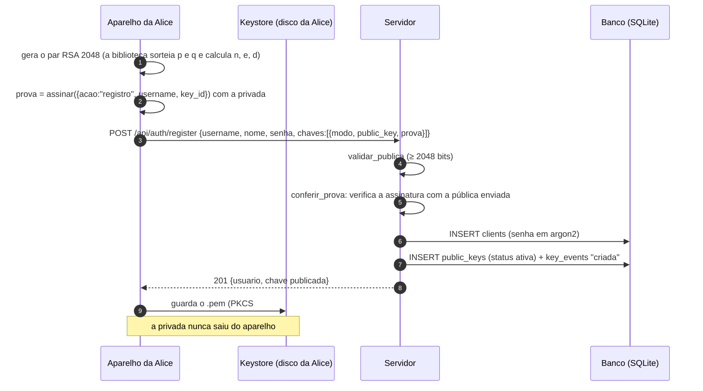
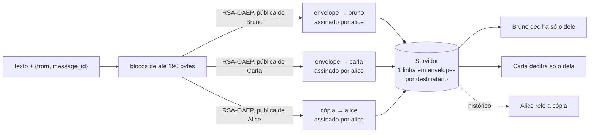

# Guia de estudo: RSA e o CriptoChat por dentro

Para quem programa mas não domina criptografia. Leia na ordem: primeiro a teoria (seções 1 a 3), depois o código
(seção 4), os diagramas (5), o glossário (6) e as perguntas (7). O apêndice A explica o código do antigo modo
didático, que ainda está no repositório mas não aparece nas telas.

> **O que o app usa hoje:** só **RSA de 2048 bits**, com **OAEP-SHA-256** para cifrar e **PSS-SHA-256** para
> assinar, pela biblioteca `cryptography` ([shared/crypto/rsa_real.py](../../shared/crypto/rsa_real.py)). Todas as
> telas fixam esse modo ([frontend/pages/layout.py:30-31](../../frontend/pages/layout.py#L30-L31)). Os números
> pequenos da seção 2 servem só para entender a matemática.

---

## 1. O que estamos protegendo

Segurança da informação costuma ser dividida em três pilares:

| Pilar | Pergunta | No CriptoChat |
|---|---|---|
| **Confidencialidade** (o nosso foco) | Só quem deve consegue **ler**? | Cifra RSA-OAEP com a chave pública do destinatário |
| **Integridade** | Alguém **alterou** no caminho? | Assinatura RSA-PSS sobre o envelope inteiro |
| **Autenticidade** | Veio mesmo de **quem diz**? | Assinatura com a privada do remetente e prova de posse da chave |

"Ponta a ponta" (E2E) quer dizer: cifra no aparelho de quem envia e decifra só no aparelho de quem recebe. O servidor
no meio só vê bytes embaralhados.

---

## 2. RSA do zero

### 2.1 A ideia: cadeado e chave

Imagine um cadeado aberto que qualquer pessoa pode fechar, mas que só você abre. Você distribui cópias do **cadeado
aberto** (a **chave pública**) para todo mundo e guarda a **chave** dele (a **chave privada**). Quem quer te mandar um
segredo põe numa caixa e fecha com o seu cadeado; nem quem fechou consegue abrir de novo. Isso é **criptografia
assimétrica**: chaves diferentes para fechar e para abrir.

A assinatura é o uso ao contrário: você "fecha" algo com a privada, e qualquer pessoa confere com a pública que só
você poderia ter feito aquilo.

### 2.2 A matemática necessária

- **Primo**: número divisível só por 1 e por ele mesmo (2, 3, 5, 7, 11, …, 53, 61, …).
- **Módulo (`mod`)**: o resto da divisão. `17 mod 5 = 2`. Fazer contas "mod n" é como um relógio de n horas: o
  resultado sempre fica entre 0 e n−1.
- **Exponenciação modular**: `mᵉ mod n`. Os números ficam pequenos porque reduzimos mod n a cada passo.
- **Coprimos**: dois números sem divisor comum além de 1. `mdc(17, 3120) = 1`, então são coprimos.
- **φ(n)** (função totiente de Euler): quantos números de 1 a n são coprimos com n. Se `n = p·q`, com p e q primos,
  `φ(n) = (p−1)(q−1)`. **Só é fácil de calcular se você conhece p e q.**
- **Inverso modular**: o número d tal que `e·d mod φ(n) = 1`. Calcula-se com o algoritmo de **Euclides estendido**.

### 2.3 Exemplo numérico completo (o mesmo "exemplo clássico" do Laboratório)

**Geração das chaves**

| Passo | Conta | Resultado |
|---|---|---|
| 1. Escolher dois primos | p = 61, q = 53 | |
| 2. Módulo (público) | n = 61 × 53 | **n = 3233** (12 bits) |
| 3. Totiente (secreto) | φ = 60 × 52 | φ = 3120 |
| 4. Expoente público | e coprimo com 3120 | **e = 17** |
| 5. Expoente privado | d = 17⁻¹ mod 3120 | **d = 2753** (confere: 17 × 2753 = 46801 = 15 × 3120 + 1) |

Chave pública = **(e = 17, n = 3233)**. Chave privada = **(d = 2753, n = 3233)**. p, q e φ são jogados fora.

**Cifrar** a mensagem m = 65 (a letra "A" em ASCII):

`c = 65¹⁷ mod 3233 = 2790`

**Decifrar**:

`m = 2790²⁷⁵³ mod 3233 = 65` ✓

**Square-and-multiply** (como o computador calcula 65¹⁷ mod 3233 sem números gigantes). O expoente 17 em binário é
`10001`. Para cada bit, eleva o resultado ao quadrado e, se o bit for 1, multiplica pela base. Sempre mod 3233:

| bit | r² mod n | × 65 mod n (se bit = 1) |
|---|---|---|
| 1 | 1² = 1 | 1 × 65 = **65** |
| 0 | 65² = 4225 → **992** | — |
| 0 | 992² → **1232** | — |
| 0 | 1232² → **1547** | — |
| 1 | 1547² → 789 | 789 × 65 → **2790** |

A `cryptography` faz a mesma coisa internamente, em C e com otimizações, com números de 617 dígitos.

**Assinar** um hash h = 123: `s = 123²⁷⁵³ mod 3233 = 2746`. **Verificar**: `2746¹⁷ mod 3233 = 123`. Como dá igual ao
hash, a assinatura é válida.

### 2.4 Por que funciona

Pelo **teorema de Euler**, para m coprimo com n, `m^φ(n) ≡ 1 (mod n)`. Como `e·d = 1 + k·φ(n)`:

`(mᵉ)ᵈ = m^(e·d) = m^(1 + k·φ(n)) = m · (m^φ(n))ᵏ ≡ m · 1ᵏ = m (mod n)`

(Também vale para m não coprimo, pelo Teorema Chinês do Resto. Não precisa entrar nisso na apresentação.)

### 2.5 Por que é seguro

Quem tem só (e, n) precisa de d. Para achar d precisa de φ(n); para φ(n) precisa de p e q; para p e q precisa
**fatorar n**. Fatorar 3233 é instantâneo. Fatorar um n de 2048 bits (617 dígitos) é inviável com a tecnologia atual:
o maior número RSA fatorado publicamente tem 829 bits ([frontend/pages/laboratorio.py:141-143](../../frontend/pages/laboratorio.py#L141-L143)).
O Laboratório (`/laboratorio`) mede isso: com o algoritmo Pollard rho, o tempo dobra a cada 4 bits de n
([frontend/medicoes.py:64-67](../../frontend/medicoes.py#L64-L67)).

### 2.6 O limite de tamanho: blocos

Só dá para cifrar um número **menor que n**. Com 2048 bits, n tem 256 bytes, mas o OAEP ocupa 66 deles, então sobram
`256 − 2·32 − 2 = 190` bytes de mensagem por bloco ([shared/crypto/rsa_real.py:26-29](../../shared/crypto/rsa_real.py#L26-L29)).
Cada bloco cifrado tem 256 bytes.

Mensagens maiores viram vários blocos, cada um cifrado separadamente ([shared/crypto/envelope.py:91-99](../../shared/crypto/envelope.py#L91-L99)).
O limite é de 2000 caracteres ([shared/crypto/blocos.py:11](../../shared/crypto/blocos.py#L11)): até ~8 KB em UTF-8,
ou seja, até 43 blocos de 256 bytes **por destinatário**.

---

## 3. Padding e criptografia híbrida

### 3.1 Por que não usar RSA "de livro" (sem padding)

A conta pura `c = mᵉ mod n` tem quatro problemas:
1. **É determinística**: a mesma mensagem sempre gera o mesmo cifrado. Com n = 3233, "H" (72) sempre vira 3000. Um
   espião pode montar um dicionário, e blocos repetidos aparecem repetidos no cifrado.
2. **É maleável**: `c₁ · c₂ mod n` é o cifrado de `m₁ · m₂`. Dá para manipular o cifrado sem saber o texto.
3. **Não detecta erro**: decifrar com a chave errada não falha, só devolve lixo.
4. **Assinatura forjável**: elevar um hash a d sem estrutura permite combinar assinaturas para forjar outras.

### 3.2 OAEP (cifra) e PSS (assinatura): o que o app usa

**OAEP** (*Optimal Asymmetric Encryption Padding*) embrulha cada bloco antes de cifrar: mistura uma semente
**aleatória** e um hash, numa estrutura que é conferida ao decifrar. Resultados:
- o mesmo texto cifrado duas vezes dá resultados diferentes (cifra probabilística). Por isso, no grupo, o envelope do
  Bruno e o da Carla não se parecem;
- chave errada ou bloco adulterado fazem a estrutura não conferir, e o resultado é um erro (`ValueError`) em vez de
  lixo ([shared/crypto/rsa_real.py:73-75](../../shared/crypto/rsa_real.py#L73-L75)). É o que o experimento "chave
  errada" do Inspetor mostra ([frontend/inspecao.py:111-123](../../frontend/inspecao.py#L111-L123));
- custo: 66 bytes por bloco (2 × 32 do SHA-256, mais 2).

**PSS** (*Probabilistic Signature Scheme*) faz o mesmo para assinaturas: hash, sal aleatório e estrutura verificável.

### 3.3 Criptografia híbrida (o que a indústria usa, e nós não)

RSA é lento e só cifra blocos pequenos. Na prática (TLS, PGP, Signal), faz-se assim:
1. sortear uma chave **AES** de 256 bits;
2. cifrar a mensagem inteira com AES-GCM (rápido, sem limite de tamanho e com integridade);
3. cifrar **só a chave AES** com o RSA de cada destinatário.

Num grupo, a mensagem é cifrada **uma vez** e só a chave AES é "envelopada" por destinatário. O plano original
previa isso (campo `wrapped_key`), mas a equipe decidiu usar RSA puro porque o trabalho é sobre RSA
([docs/PLANO_IMPLEMENTACAO.md:21](../PLANO_IMPLEMENTACAO.md#L21)). É a principal melhoria futura.

---

## 4. O código crítico, trecho a trecho

### 4.1 RSA real: [shared/crypto/rsa_real.py](../../shared/crypto/rsa_real.py)

```python
BITS_PADRAO = 2048                                                            # 11
EXPOENTE_PUBLICO = 65537                                                      # 12
_HASH = hashes.SHA256()                                                       # 13
_OAEP = padding.OAEP(mgf=padding.MGF1(algorithm=_HASH), algorithm=_HASH, label=None)   # 15
_PSS = padding.PSS(mgf=padding.MGF1(_HASH), salt_length=padding.PSS.MAX_LENGTH)        # 16
```

- `tamanho_bloco` (26–29): `key_size // 8 − 2 · 32 − 2` = 190 bytes;
- `cifrar_bloco` (53–56): recusa um bloco maior que 190 bytes e faz `self._chave.encrypt(bloco, _OAEP)`;
- `verificar` (58–63): `verify(assinatura, dados, _PSS, _HASH)`; devolve `False` em vez de lançar exceção;
- `decifrar_bloco` (73–75): `decrypt(…, _OAEP)`; com a chave errada, lança `ValueError`;
- `assinar` (77–78): `sign(dados, _PSS, _HASH)`;
- `exportar` (80–86): **PKCS#8 cifrado com a senha** (`BestAvailableEncryption`). É assim que a privada vai para o
  disco;
- `gerar` (96–97): `rsa.generate_private_key(public_exponent=65537, key_size=2048)`. A biblioteca sorteia os primos,
  calcula n, φ e d exatamente como na seção 2.3.

### 4.2 Identidade da chave: [shared/crypto/base.py:15-33](../../shared/crypto/base.py#L15-L33)

- `fingerprint` = SHA-256 da chave pública em forma canônica (DER);
- `key_id` = `"k_"` seguido dos 16 primeiros caracteres hexadecimais do fingerprint. É o "nome" da chave nos
  envelopes e no banco;
- `numero_seguranca` = 60 dígitos derivados do fingerprint, para comparar pessoalmente (no estilo do Signal).

### 4.3 Do texto aos blocos: [shared/crypto/blocos.py](../../shared/crypto/blocos.py)

```python
def codificar_conteudo(remetente, message_id, texto) -> bytes:          # 19
    if len(texto) > MAX_TEXTO_CARACTERES: raise MensagemGrandeDemais(…)
    conteudo = {"from": remetente, "message_id": message_id, "text": texto}
    return json.dumps(conteudo, ensure_ascii=False, sort_keys=True, separators=(",", ":")).encode("utf-8")
```

O que é cifrado não é só o texto: é um JSON com **o remetente e o id dentro**. `dividir` (33–39) fatia esses bytes
em pedaços de até 190 bytes.

### 4.4 Montar os envelopes: [shared/crypto/envelope.py:61-132](../../shared/crypto/envelope.py#L61-L132)

```python
    alvos = dict(destinatarios)                                          # 78
    if incluir_copia:
        alvos.setdefault(remetente, privada.publica)                      # 80: cópia para mim mesmo
    ...
    conteudo = codificar_conteudo(remetente, message_id, texto)           # 86
    for usuario, publica in alvos.items():                                # 91: UM envelope por destinatário
        blocos = dividir(conteudo, publica.tamanho_bloco, completar=publica.blocos_fixos)
        ...
            cifrado = publica.cifrar_bloco(bloco, passos)                 # 98: com a PÚBLICA do destinatário
        envelope = Envelope(message_id=..., from_=remetente, from_key_id=privada.publica.key_id,
                            to=usuario, to_key_id=publica.key_id, mode=modo, sent_at=sent_at,
                            blocks=[_b64(c) for c in cifrados])           # 110-120
        dados = envelope.dados_assinados()                                # 124
        envelope.signature = _b64(privada.assinar(dados, passos))         # 125: com a PRIVADA do remetente
```

O que é assinado ([shared/schemas.py:142-145](../../shared/schemas.py#L142-L145)): **todos os campos do envelope menos
a assinatura**, em JSON canônico (chaves ordenadas). Isso inclui `blocks`, então trocar, remover ou reordenar um bloco
quebra a assinatura.

### 4.5 Abrir um envelope: [shared/crypto/envelope.py:135-206](../../shared/crypto/envelope.py#L135-L206)

A ordem das verificações (vale saber de cor):
1. **143–148**: o `to_key_id` é o da minha privada? O `from_key_id` é o da pública que tenho do remetente?
2. **150–163**: verifica a **assinatura** com a pública do remetente. Se falhar, `AssinaturaInvalida`, e nem decifra.
3. **165–186**: decifra cada bloco com a **minha privada** e junta os pedaços.
4. **188–198**: decodifica o JSON e confere que `from` e `message_id` **de dentro** batem com os **de fora**.

Por que o passo 4? A assinatura vem **depois** da cifra (assina o cifrado). Sem o cabeçalho interno, Eva poderia pegar
o envelope que a Alice mandou ao Bruno, tirar a assinatura da Alice, pôr `from: eva` e assinar com a privada dela, e
o Bruno acharia que a mensagem é da Eva. Com o `from` escondido dentro da cifra, a troca é detectada
(`CabecalhoInconsistente`).

### 4.6 Cadastro no aparelho: [frontend/sessao.py:47-76](../../frontend/sessao.py#L47-L76)

```python
        real = await asyncio.to_thread(rsa_real.gerar)                             # 60: par RSA 2048
        privadas = [real, didatica]                                                # 64
        chaves = [self._chave_com_prova(p, username) for p in privadas]           # 66: prova de posse
        registro = await self.api.registrar(RegistroIn(..., chaves=chaves))       # 69: só públicas e provas
        keystore = Keystore(self.raiz_keystore, username, senha)                   # 71
        for privada in privadas:
            keystore.guardar(privada)                                              # 72-73: privadas no disco local
```

`_chave_com_prova` (136–142) assina `{"acao":"registro","key_id":…,"nonce":"","username":…}`
([shared/crypto/prova.py:12-14](../../shared/crypto/prova.py#L12-L14)) e manda só `modo`, `public_key` e `prova`
([shared/schemas.py:19-22](../../shared/schemas.py#L19-L22)). **Não existe campo para a privada no protocolo.**

> **Atenção às linhas 53–57 e 64:** o cadastro ainda gera **também** um par didático de 32 bits (`didatica`) e o
> publica junto com o real. É um resíduo da versão anterior: nenhuma tela usa esse par. Veja o apêndice A e a
> pergunta 19.

### 4.7 Keystore: [frontend/keystore.py](../../frontend/keystore.py)

- `guardar` (52–71): grava `<key_id>.pem` cifrado com a senha e atualiza o `index.json` com a chave ativa.
- `carregar` (73–85): acha a privada pelo `key_id`. Por isso, depois de uma troca, o envelope antigo (que aponta o
  `to_key_id` antigo) ainda abre.
- `desativar` (104–108): depois de uma exclusão sem apagar, a privada fica guardada mas deixa de ser a ativa.
- `apagar` (126–135): `unlink` do arquivo. O histórico daquela chave fica ilegível.
- `lembrar_contato` (121–124): guarda o último fingerprint de cada contato (detecta troca entre sessões).

### 4.8 Servidor: validar e publicar ([backend/chaves.py:18-59](../../backend/chaves.py#L18-L59))

- `validar_publica` (18–34): interpreta a chave e recusa chave real com menos de 2048 bits;
- `conferir_prova` (37–44): remonta a mesma mensagem da prova e **verifica a assinatura com a pública enviada**. Só
  passa quem tem a privada correspondente;
- `publicar` (47–59): grava em `public_keys` (key_id, dono, modo, public_key, fingerprint) e um `KeyEvent "criada"`.

O endpoint de cadastro ([backend/api/auth.py:18-45](../../backend/api/auth.py#L18-L45)) valida **todas** as chaves
antes de gravar qualquer coisa (linhas 23–28) e torna o primeiro usuário administrador (30–36).

### 4.9 Servidor: relay ([backend/ws/relay.py:110-177](../../backend/ws/relay.py#L110-L177))

`registrar_envio` confere, nesta ordem:
- se a conversa existe e o remetente participa dela (113–118), e se o `message_id` é inédito (119–120, contra replay);
- se há **exatamente um envelope por participante**, cópia incluída (122–128);
- se cada envelope tem o remetente do token, o modo da conversa e foi assinado com a chave **ativa** do remetente
  (130–139);
- se a chave de cada destinatário ainda é a ativa. Se não for, devolve `key_outdated` com a chave atual (141–156);
- então grava `Message` **sem conteúdo** (159) e um `EnvelopeRegistro` por destinatário com o JSON exato (165–173).

Repare no que **não** há aqui: nenhuma chamada para decifrar ou verificar assinatura (docstring nas linhas 1–6).

### 4.10 Cache de chaves e alerta de troca: [frontend/key_cache.py](../../frontend/key_cache.py)

- `obter` (40–49): busca no servidor só as chaves que não estão no cache;
- `_conferir` (87–91): a chave entregue tem de ter o key_id e o fingerprint anunciados. Isso confere coerência, não
  autenticidade;
- `registrar_fingerprint` (75–81): se o fingerprint de um contato mudou, chama `ao_mudar`, e o Mensageiro mostra
  "⚠ A chave de X mudou" ([frontend/mensageiro.py:370-379](../../frontend/mensageiro.py#L370-L379)).

### 4.11 Troca e exclusão

- **Troca, no aparelho** ([frontend/sessao.py:87-112](../../frontend/sessao.py#L87-L112)): gera um par novo e o
  guarda **antes** de publicar (103), para não perder a privada se a resposta se perder; pede o nonce (104); assina com
  a **nova** privada (106); publica (108); ativa (111).
- **Troca, no servidor** ([backend/api/keys.py:82-116](../../backend/api/keys.py#L82-L116)): exige nonce válido, do
  próprio usuário, não usado e não expirado (90–92); **queima** o nonce (93–94); valida e confere a prova com o nonce
  (96–97); marca a antiga como `substituida` (99–103); publica a nova (104); avisa os interessados com `key_changed`
  (108–111).
- **Exclusão, no servidor** ([backend/api/keys.py:122-143](../../backend/api/keys.py#L122-L143)): pede a **senha de
  novo** (127); marca `revogada` (132–133); avisa com `key_revoked` (136–139).
- **Exclusão, no aparelho** ([frontend/sessao.py:114-121](../../frontend/sessao.py#L114-L121)): `apagar_modo` ou
  `desativar`, conforme a caixa "Apagar também as chaves privadas".
- **Quem é avisado** ([backend/chaves.py:62-68](../../backend/chaves.py#L62-L68)): quem já buscou a chave (tabela
  `key_access`) e quem divide conversa com o dono.

---

## 5. Diagramas

### 5.1 Cadastro e publicação da chave



### 5.2 Envio A → B

```mermaid
sequenceDiagram
    autonumber
    participant A as Aparelho da Alice
    participant S as Servidor (relay)
    participant DB as Banco
    participant B as Aparelho do Bruno
    A->>S: GET /api/keys?users=bruno (se não estiver no cache)
    S->>DB: registra key_access (alice buscou a chave de bruno)
    S-->>A: public_key de bruno + key_id + fingerprint
    A->>A: confere key_id e fingerprint; memoriza o fingerprint
    A->>A: conteúdo = {from, message_id, text} → blocos de até 190 bytes
    A->>A: env_B: blocos RSA-OAEP com a PÚBLICA de bruno; RSA-PSS com a PRIVADA de alice
    A->>A: env_A (cópia): cifrado com a PÚBLICA de alice; assinado
    A->>S: WS {type:"send", envelopes:[env_B, env_A]}
    S->>S: confere participantes, remetente e key_ids ativos
    S->>DB: messages (sem texto) + envelopes (JSON cifrado, um por destinatário)
    S-->>A: {type:"sent"}
    S->>B: WS {type:"message", envelope: env_B} (passando pelos nós)
    B->>B: verifica a assinatura com a pública de alice
    B->>B: decifra com a PRIVADA de bruno; confere from/message_id internos
    B->>S: WS {type:"ack"}
    S-->>A: WS {type:"delivered", to:"bruno"}
```

### 5.3 Envio A → B e C (grupo)



### 5.4 Troca de chave

```mermaid
sequenceDiagram
    autonumber
    participant B as Aparelho do Bruno
    participant S as Servidor
    participant DB as Banco
    participant A as Aparelho da Alice
    B->>B: gera um par novo; guarda no keystore (inativo)
    B->>S: POST /api/keys/challenge
    S->>DB: key_challenges (nonce, 60 s, usado=0)
    S-->>B: nonce
    B->>B: prova = assinar({acao:"troca", username, key_id_novo, nonce}) com a NOVA privada
    B->>S: PUT /api/me/key {modo, public_key, nonce, prova}
    S->>DB: nonce usado=1 (queimado mesmo se o resto falhar)
    S->>S: confere a prova
    S->>DB: antiga → substituida; nova → ativa; key_events
    S-->>B: chave publicada
    B->>B: ativa a nova; a antiga fica no keystore (lê o histórico)
    S->>A: WS {type:"key_changed", user:"bruno", fingerprint}
    A->>A: invalida o cache; alerta "a chave de bruno mudou"
```

---

## 6. Glossário

| Termo | Significado |
|---|---|
| **Confidencialidade** | Só o destinatário consegue ler o conteúdo |
| **Integridade** | Qualquer alteração no caminho é detectada |
| **Autenticidade** | Dá para provar quem enviou |
| **Não repúdio** | O remetente não pode negar que assinou (a assinatura só sai da privada dele) |
| **Criptografia assimétrica** | Chaves diferentes para cifrar (pública) e decifrar (privada) |
| **Criptografia simétrica** | A mesma chave cifra e decifra (ex.: AES) |
| **Híbrida** | AES cifra a mensagem; RSA cifra só a chave AES |
| **E2E (ponta a ponta)** | Cifra e decifra só nos aparelhos das pontas |
| **Chave pública (e, n)** | Pode ser divulgada; cifra para o dono e verifica as assinaturas dele |
| **Chave privada (d)** | Secreta; decifra e assina |
| **Módulo n** | p × q; o tamanho de n é o "tamanho da chave" (2048 bits no app) |
| **φ(n)** | (p−1)(q−1); quem sabe φ calcula d |
| **Padding** | Preenchimento estruturado e aleatório aplicado antes de cifrar ou assinar |
| **OAEP** | Padding de cifra do RSA: torna a cifra probabilística e detecta chave errada ou adulteração |
| **PSS** | Padding de assinatura do RSA, probabilístico |
| **PKCS#1 v1.5** | Padding antigo do RSA (não usado aqui), vulnerável a ataques de oráculo (Bleichenbacher) |
| **RSA de livro** | RSA sem padding, só a conta `mᵉ mod n` (inseguro) |
| **Hash (SHA-256)** | Resumo de tamanho fixo; mudar 1 bit da entrada muda tudo |
| **Assinatura digital** | O hash dos dados processado com a privada; verificável com a pública |
| **Fingerprint** | Hash da chave pública; identifica a chave |
| **key_id** | `k_` + 16 hex do fingerprint; o nome da chave no sistema |
| **Número de segurança** | 60 dígitos derivados do fingerprint, para comparar pessoalmente |
| **Prova de posse** | Assinatura que prova ter a privada de uma pública |
| **Nonce** | Valor aleatório de uso único (impede reaproveitar uma prova) |
| **Replay** | Reenviar uma mensagem antiga capturada |
| **MITM** | *Man-in-the-middle*: alguém no meio se passa por cada lado (ex.: o servidor entrega uma pública falsa) |
| **TOFU** | *Trust on first use*: confiar na primeira chave vista e alertar se ela mudar |
| **TLS / HTTPS / WSS** | Cifra do canal de transporte (não usada aqui) |
| **Máscara do WebSocket** | XOR obrigatório nos quadros que saem do cliente; não é criptografia (o Wireshark a desfaz) |
| **Forward secrecy** | Vazar a chave hoje não revela mensagens passadas (não temos) |
| **Metadados** | Quem, quando, para quem, quanto: visíveis ao servidor |
| **Revogação** | Marcar uma chave como não mais válida |
| **Rotação ou troca** | Substituir a chave ativa por uma nova |
| **Keystore** | Onde o aparelho guarda as privadas (`data/keystoreX/<user>/`) |
| **Euclides estendido** | Algoritmo que acha o inverso modular (d) |
| **Square-and-multiply** | Exponenciação modular eficiente, bit a bit do expoente |
| **Pollard rho** | Algoritmo de fatoração usado no Laboratório para quebrar chaves pequenas |
| **argon2** | Função de hash de senha lenta e resistente a força bruta (usada no login) |

---

## 7. Perguntas prováveis do professor

**1. Onde a chave privada é gerada e guardada? Ela vai para o servidor?**
É gerada no aparelho, no cadastro ([frontend/sessao.py:60](../../frontend/sessao.py#L60)). Fica em arquivo no keystore
local, cifrada com a senha ([shared/crypto/rsa_real.py:80-86](../../shared/crypto/rsa_real.py#L80-L86)). Nunca vai
para o servidor: o protocolo não tem campo para ela ([shared/schemas.py:19-22](../../shared/schemas.py#L19-L22)) e
nenhuma tabela tem coluna para ela ([backend/models.py:1](../../backend/models.py#L1)). O Wireshark confirma: a palavra
`PRIVATE` não aparece em nenhum pacote.

**2. O servidor consegue ler as mensagens?**
Não. Ele só grava o envelope cifrado ([backend/ws/relay.py:165-173](../../backend/ws/relay.py#L165-L173)) e não tem
nenhuma privada. Vê os metadados: quem, para quem, quando e o tamanho.

**3. RSA puro ou híbrido? Por quê?**
RSA puro, por blocos, por decisão didática ([docs/PLANO_IMPLEMENTACAO.md:21](../PLANO_IMPLEMENTACAO.md#L21)). O correto
em produção seria híbrido (AES-GCM, com o RSA cifrando a chave AES).

**4. Qual o tamanho máximo do bloco e por quê?**
190 bytes = 256 − 2·32 − 2, porque o OAEP com SHA-256 ocupa 66 dos 256 bytes do módulo
([shared/crypto/rsa_real.py:26-29](../../shared/crypto/rsa_real.py#L26-L29)).

**5. Que padding vocês usam?**
OAEP com SHA-256 (e MGF1-SHA-256) para cifrar e PSS com SHA-256 para assinar
([shared/crypto/rsa_real.py:15-16](../../shared/crypto/rsa_real.py#L15-L16)).

**6. Por que e = 65537?**
É primo (fácil de ser coprimo com φ), tem só dois bits 1 (`10000000000000001`), o que torna a cifra rápida, e é grande
o bastante para evitar ataques de expoente pequeno.

**7. Como o Bruno sabe que a mensagem veio da Alice e não foi alterada?**
Pela assinatura com a privada da Alice sobre o envelope inteiro ([shared/crypto/envelope.py:122-127](../../shared/crypto/envelope.py#L122-L127)),
verificada antes de decifrar ([:150-163](../../shared/crypto/envelope.py#L150-L163)), e pelo cabeçalho interno
conferido depois ([:193-197](../../shared/crypto/envelope.py#L193-L197)). A demonstração de adulteração mostra a
rejeição.

**8. Num grupo, a mensagem é cifrada uma vez só?**
Não: há um envelope por participante, cada um cifrado com a pública daquele destinatário e assinado
([shared/crypto/envelope.py:91-131](../../shared/crypto/envelope.py#L91-L131)). O servidor exige exatamente um por
membro ([backend/ws/relay.py:122-128](../../backend/ws/relay.py#L122-L128)).

**9. Por que o remetente recebe uma cópia?**
Para reler o próprio histórico: o envelope para o Bruno só a privada do Bruno abre. A cópia é cifrada com a pública
do próprio remetente ([shared/crypto/envelope.py:79-80](../../shared/crypto/envelope.py#L79-L80)).

**10. E se o servidor trocar a chave pública do Bruno (MITM)?**
É a principal limitação. No primeiro contato, o aparelho confia no que o servidor entrega. Depois disso o fingerprint
fica memorizado ([frontend/keystore.py:121-124](../../frontend/keystore.py#L121-L124)) e qualquer mudança gera um
alerta ([frontend/mensageiro.py:370-379](../../frontend/mensageiro.py#L370-L379)). Comparar os números de segurança
pessoalmente detecta o ataque. O alerta não bloqueia o envio.

**11. Como impedem alguém de publicar uma chave em nome de outro?**
Publicar exige estar autenticado como o dono (token) e a prova de posse, isto é, assinar com a privada correspondente
([backend/chaves.py:37-44](../../backend/chaves.py#L37-L44)). Na troca, a prova inclui um nonce do servidor, de uso
único e válido por 60 segundos ([backend/api/keys.py:74-97](../../backend/api/keys.py#L74-L97)).

**12. O que acontece com as mensagens antigas quando a chave é trocada?**
Continuam legíveis: a privada antiga fica no keystore e é encontrada pelo `to_key_id`
([frontend/keystore.py:73-85](../../frontend/keystore.py#L73-L85)), e a pública antiga fica no banco como `substituida`
para verificar as assinaturas ([backend/api/keys.py:53-62](../../backend/api/keys.py#L53-L62)).

**13. E quando a chave é excluída?**
O servidor a marca como `revogada` e passa a recusar mensagens para o usuário
([backend/ws/relay.py:143-150](../../backend/ws/relay.py#L143-L150)). Se o usuário também apagar a privada, o histórico
cifrado para ela fica ilegível para sempre: os envelopes continuam no servidor, mas ninguém tem a chave.

**14. E se o token de login da Alice vazar?**
O atacante pode agir como a Alice no servidor (enviar, buscar chaves), mas **não lê** nada, porque não tem a privada.
Também não exclui a chave, que exige a senha ([backend/api/keys.py:127](../../backend/api/keys.py#L127)), nem troca sem
gerar um par novo com prova. O banco guarda só o SHA-256 do token ([backend/auth.py:36-45](../../backend/auth.py#L36-L45)).

**15. Como as senhas são guardadas?**
Com argon2 ([backend/auth.py:25-33](../../backend/auth.py#L25-L33)). Mas atenção: a mesma senha cifra o keystore, e ela
viaja em claro no login, porque não há TLS. O Wireshark mostra isso.

**16. Tem proteção contra replay?**
Sim: o `message_id` é único. O servidor recusa um repetido ([backend/ws/relay.py:119-120](../../backend/ws/relay.py#L119-L120))
e o aparelho ignora o que já tem ([frontend/mensageiro.py:317-322](../../frontend/mensageiro.py#L317-L322)).

**17. Por que 2048 bits? Como vocês mostram que chave pequena é insegura?**
No Laboratório (`/laboratorio`): a chave do exemplo clássico (n = 3233) é fatorada na hora, e daí saem φ e d
([shared/crypto/fatoracao.py:65-69](../../shared/crypto/fatoracao.py#L65-L69)). Para a chave real, a tela mostra que
seriam necessários ~2⁵¹² passos, e os gráficos extrapolam o tempo de fatoração por tamanho de chave.

**18. O que acontece se alguém tentar decifrar com a chave errada?**
O OAEP percebe que a estrutura não confere e lança erro, em vez de devolver lixo
([shared/crypto/rsa_real.py:73-75](../../shared/crypto/rsa_real.py#L73-L75)). O Inspetor tem esse experimento
([frontend/inspecao.py:111-123](../../frontend/inspecao.py#L111-L123)).

**19. No banco há duas chaves por usuário, e no keystore há um `.json`. O que é isso?**
É um resíduo da versão anterior, que tinha um "modo didático" com RSA de 32 bits. As telas foram limpas para usar só o
RSA 2048 ([frontend/pages/layout.py:30-31](../../frontend/pages/layout.py#L30-L31)), mas o cadastro ainda gera e publica
esse par pequeno ([frontend/sessao.py:53-57](../../frontend/sessao.py#L53-L57)). Nenhuma tela cria conversa nesse modo,
então nenhuma mensagem é cifrada com ele. Mesmo assim, é uma chave fraca publicada no diretório: a correção é parar de
gerá-la no cadastro (veja o apêndice A).

**20. Há sigilo futuro (forward secrecy)?**
Não. Os envelopes ficam guardados no servidor; se uma privada vazar, todo o histórico dela pode ser decifrado. A
melhoria seria usar troca de chaves efêmeras (Diffie-Hellman), como no Signal.

**21. Por que não usar TLS?**
Não foi implementado (`http://` e `ws://` em [frontend/main.py:17-18](../../frontend/main.py#L17-L18)). O conteúdo
continua protegido pelo E2E, mas metadados, token e senha ficam expostos. Em produção o TLS é obrigatório: ele
complementa o E2E, não o substitui.

**22. O que exatamente o servidor guarda de uma mensagem?**
Em `messages`: id, conversa, remetente, `sent_at`, quando chegou e os saltos ([backend/models.py:122-132](../../backend/models.py#L122-L132)).
Em `envelopes`: um por destinatário, com `to_key_id`, status e o JSON do envelope (metadados, blocos cifrados e
assinatura) ([backend/models.py:135-148](../../backend/models.py#L135-L148)). Nenhum texto.

**23. A chave privada no disco está protegida?**
Sim: em PKCS#8 cifrado com a senha. Duas ressalvas: "apagar a privada" é um `unlink` comum, não um apagamento seguro; e
o `.json` do par didático residual guarda o `d` em claro.

---

## Apêndice A: o código do antigo modo didático

O commit `142397a` ("removing didatic form") retirou o modo didático **só das telas**. Continuam no repositório:

| O quê | Onde | Situação |
|---|---|---|
| RSA implementado do zero (Miller-Rabin, Euclides estendido, square-and-multiply, sem padding) | [shared/crypto/rsa_didatico.py](../../shared/crypto/rsa_didatico.py) | usado só pelo cadastro e pelos testes |
| Geração do par didático no cadastro | [frontend/sessao.py:53-57](../../frontend/sessao.py#L53-L57) e [:64](../../frontend/sessao.py#L64) | **ainda ativo**: publica uma chave de 32 bits por usuário |
| Gravação do `.json` com o `d` em claro | [frontend/keystore.py:58-60](../../frontend/keystore.py#L58-L60), [shared/crypto/rsa_didatico.py:227-229](../../shared/crypto/rsa_didatico.py#L227-L229) | ainda ativo |
| Aceitação de chaves didáticas no servidor | [backend/chaves.py:29-33](../../backend/chaves.py#L29-L33) | ainda ativo |
| Conversas didáticas ocultas nas telas | [frontend/pages/layout.py:292-294](../../frontend/pages/layout.py#L292-L294) | filtro de exibição |
| Laboratório com seletor "didático / real" | [frontend/pages/laboratorio.py:56](../../frontend/pages/laboratorio.py#L56) | quebra a chave didática de um usuário se o seletor ficar em "didático" |

Se o professor abrir `rsa_didatico.py`, as funções correspondem exatamente à seção 2:
- `gerar_primo` (67–72) sorteia um candidato com `secrets.randbits` e testa com `eh_primo`, o Miller-Rabin de 40
  rodadas (43–64);
- `gerar_parametros` (119–149) calcula n, φ, e e d;
- `inverso_modular` (36–40) usa o Euclides estendido `egcd` (26–33);
- `pow_mod_trace` (75–91) é o square-and-multiply da tabela da seção 2.3;
- `cifrar_bloco` e `decifrar_bloco` (188–192 e 214–221) são `mᵉ mod n` e `cᵈ mod n` sem padding.

Ele servia para mostrar a matemática com números legíveis; hoje é código morto do ponto de vista do usuário, mas não do
cadastro. A limpeza completa seria remover a geração do par didático em `sessao.cadastrar` e recusar `modo =
"didatico"` em `validar_publica`.
